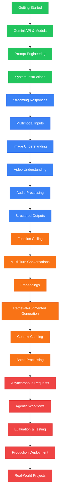

# Google SDK Masterclass

> Venkata Bhattaram (c) 2026

An extensive, beginner-to-expert **Google SDK Masterclass** with hands-on code examples — from installing the Google Gen AI Python SDK and making your first Gemini API request, through the Gemini API and models, prompt engineering, system instructions, streaming responses, multimodal inputs, image and video understanding, audio processing, structured outputs, function calling, multi-turn conversations, embeddings, retrieval-augmented generation (RAG), context caching, batch processing, asynchronous requests, agentic workflows, evaluation, testing, and production deployment.

## Learning Path

**Green = Beginner** &nbsp; | &nbsp; **Blue = Intermediate** &nbsp; | &nbsp; **Orange = Advanced** &nbsp; | &nbsp; **Red = Expert**

The Masterclass progressively moves from basic Gemini API integration to advanced multimodal applications, retrieval systems, agentic workflows, and production-ready applications:

**Installation → Gemini API → Prompt Engineering → Streaming → Multimodal AI → Image & Video Understanding → Audio Processing → Structured Outputs → Function Calling → Conversations → Embeddings → RAG → Context Caching → Batch Processing → Async Requests → Agentic Workflows → Evaluation → Production**

## CONTENTS

### 01. Foundations

- [Introduction](./01-get-started/md/introduction.md)
- [Installation](./01-get-started/md/installer.md)

> Venkata Bhattaram (c) 2026

This Masterclass is intended for educational purposes, practical experimentation, and hands-on learning with Google's Gen AI ecosystem.

